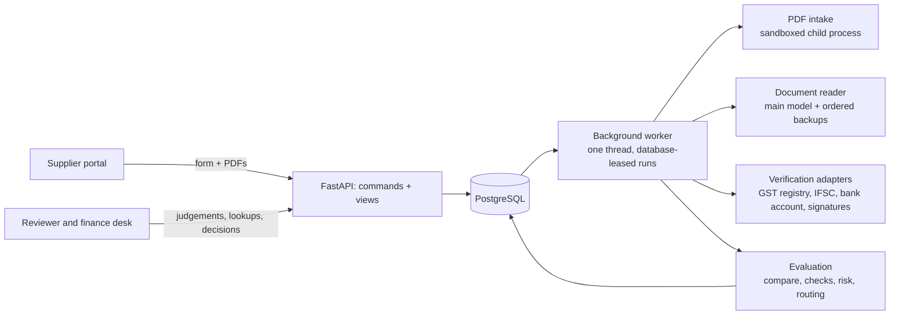
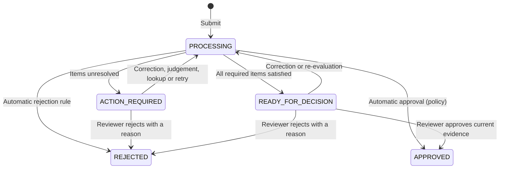

# Architecture

This document describes Verify as built: the components, the data model, the checks, how an application is routed, and how the process compares with real supplier onboarding in India. For the hosted setup, see [DEPLOYMENT.md](DEPLOYMENT.md).

## Scope and principles

A supplier applies to one buyer with a form and PDF documents. Verify decides **approved**, **pending** (with what is needed from whom) or **rejected**, with reasons, and tells the supplier what to do.

- **Scope.** Indian private limited companies and LLPs supplying services. Other entity types, and suppliers without GST registration, go to a reviewer as out of scope. They are never rejected for it.
- **Two fictional buyers, each with its own versioned policy** (`backend/policies/`):
  - **Meridian** approves clean, low-risk applications automatically and uses a simulated GST registry.
  - **Kestrel** has a person approve every application and record the GST registry lookup.
- **People.** Suppliers, two procurement reviewers per buyer and one finance reviewer per buyer. One buyer's staff can't see the other buyer's cases.
- **The system never rejects on its own judgement.** It rejects automatically only on an explicit policy rule (today: the supplier declined the code of conduct). Anything uncertain goes to a named person with the evidence.

## Components

| Layer | Where | What it does |
|---|---|---|
| API | `app/api/`, `app/services/commands.py`, `app/services/views.py` | Commands do every write; views build separate pages for suppliers and for staff. Every write carries an `operation_id`, so a retry is safe, and the `expected_version` of the screen the person saw; an outdated screen gets `409 stale_view`. Each request also names the account its tab is showing, so a second tab signed in as someone else can't act for the first. |
| Worker | `app/pipeline/worker.py`, `runner.py` | Claims a queued run with `FOR NO KEY UPDATE SKIP LOCKED` and a lease token. Only the current lease holder may publish results, and a crashed run is reclaimed when its lease expires. When idle it checks the queue once an hour, so the free database can pause. |
| PDF intake | `app/pdf/` | Size and page limits (10 pages per file, 30 per revision). Locked, broken and non-PDF files are refused at upload. Parsing runs in a child process with a memory cap, self-tested at start-up. |
| Reading | `app/extraction/` | Each page goes to a vision model as an image, with its text layer. **The model never sees the form values.** It decides the document type from the content and fills one field template per type. Every value carries a status (found, not found, unreadable, ambiguous), a page and a quote. If the main model is slow or failing, the read is handed over to up to three ordered backups. Readings are cached by file hash and reading-contract version. |
| Grounding | `app/pipeline/compare.py`, `checks.py` | A value counts as proven only when our code finds it in the page's own text layer. A value seen only in an image needs a person's confirmation. Text hidden in the file (covered digits, white on white) is detected and never count as proof. |
| Verification | `app/pipeline/registry.py`, `app/verification/bank.py`, `app/pdf/signature.py` | Each lookup is stored as a `Verification` record (method, result, observed data, source, actor), bound to the exact identifier it checked. |
| Evaluation | `app/pipeline/checks.py`, `risk.py`, `decide.py`, `master.py` | Pure functions: inputs in, findings out, with no database and no model. This is the main tested surface. |
| Approval | `app/pipeline/finalise.py`, `crossfacts.py` | One approval path, for people and for automatic approval. Under locks it re-checks the current revision, the current rules, that nothing is open, and that the facts from other suppliers (duplicates) haven't changed. |
| Frontend | `frontend/src/` (React 19, Vite, Tailwind) | Supplier home and form; staff dashboard and case view: findings, tasks, live run log, history, documents, risk and vendor master record. |

## Data model

- **Vendor:** a supplier at one buyer. **VendorProfile:** an approved snapshot of it.
- **Request:** a first onboarding, or a change to an approved vendor. It moves through the states below.
- **Revision:** one submitted packet (form plus documents) that can't be changed afterwards. A correction is a new revision.
- **Document / Extraction:** a file and its readings. A reading reused for an identical file is linked to the original.
- **Run / RunEvent:** one processing attempt and its live log. Each event can carry separate, supplier-safe wording.
- **Assessment / CheckResult:** an evaluation pinned to a policy version and an engine version.
- **Task:** one blocker with one owner (supplier, reviewer, finance or system). Tasks are independent, so clearing one never clears another.
- **ReviewResolution:** a person's judgement, bound to the finding's **evidence fingerprint**. If the evidence changes, the judgement no longer counts. A refusal stores the internal reasoning and the request to the supplier separately. Accepting a bank change also stores how the change was confirmed.
- **Verification, Decision, Message, AuditEvent:** a source result; an approval or rejection with its rule, actor and assessment; a message to the supplier; and a log of everything.

## Checks

| Group | What is checked | A failure goes to |
|---|---|---|
| Completeness | Required fields and documents from the policy, including conditional ones (GSTIN only if GST-registered, the Udyam certificate only if MSME). The document type comes from the content, so a wrong document in a slot is caught. | Supplier |
| Scope | An entity type outside the policy; not GST-registered | Reviewer |
| Formats and ID rules | The PAN's format, and its 4th letter matching the entity type (C for a company, F for an LLP). The GSTIN's format and check digit, and that it contains the PAN. The GSTIN state code and the CIN state against the address. Formats of the Udyam number, IFSC, PIN code and e-mail address. | Supplier; state differences go to a reviewer |
| Consistency | The form against every document: legal name, PAN, GSTIN, CIN, account number, IFSC and more. A name difference is classed as exact, equivalent, suffix only (Pvt Ltd / Private Limited) or different. | Supplier, or a reviewer when a person must judge |
| Grounding | A value proven only by the model, from a scan or image | Reviewer confirms it against the page |
| Authenticity | Digital signatures on the PAN, incorporation, GST and MSME certificates. A valid signature from the expected authority passes. Edited after signing, or content added after signing, goes to a reviewer as high severity. An unexpected signer goes to a reviewer. No signature is only a note. | Reviewer |
| Bank | The account holder against the legal name. A trade name supported by the GST certificate goes to a reviewer; an unsupported one to the supplier. A bank proof older than 6 months goes to the supplier. One dated in the future, or an old date not confirmed from the text, goes to a reviewer. | As listed |
| Duplicates | The same bank account, PAN or GSTIN already on file for another supplier of this buyer | Reviewer |
| Sources | **GST registry:** status, legal name, taxpayer type, and 12 months of GSTR-1 and GSTR-3B filing. Not active, or a different business: supplier. Filing gaps: finance. Composition taxpayers are not judged on monthly returns. **IFSC directory:** the branch and bank against the bank named on the form. **Bank account check:** the holder name at the bank, with a match score. | As listed |
| Declarations | Code of conduct declined: automatic rejection (policy rule). Unanswered: supplier. A disclosed conflict of interest: reviewer. | As listed |
| Changes | Compared with the revision a person last cleared, never just the previous one. A bank change goes to finance, who must confirm it independently (below). Identity details changed: reviewer. A proof replaced after finance cleared it: finance again. | Finance or reviewer |

**Bank-change confirmation.** Finance can accept a changed account only after recording how it was confirmed: a call-back, an e-mail to an address on file, or in person. The contact must come from something the buyer already held: the approved record from before the change, the signed contract, or an independent lookup. A contact taken from the application doesn't count. The confirmation is bound to the account it confirmed, so switching to yet another account needs a new one. The person who confirmed it can't also give the final approval.

## Risk and approval

- **Risk** (`risk.py`) is a 0–100 score built from weighted, named red flags. Examples: a certificate edited after signing, the bank naming someone else as the holder, GST not active, filing gaps, an account or PAN shared with another supplier, a bank change, a company under a year old. Tiers: low below 25, medium from 25, high from 50. Every flag names the finding it came from.
- **Automatic approval** (when the policy allows it) needs all of these:
  - a first onboarding;
  - every check satisfied and every required verification passed;
  - risk no higher than `auto_approve_max_risk` (default: low);
  - no person having reviewed anything on the case.
- **Two approvers.** From `second_approver_from_risk` (default: high), two different people must approve.
- **Approval** creates the approved profile and the **vendor master record** (JSON or CSV, tied to the version on screen). The record holds:
  - the identity;
  - the GST type and input-credit position;
  - the MSME payment rule: 15 days without a written agreement, up to 45 with one (MSMED Act s.15);
  - a TDS suggestion under the Income-tax Act 2025 s.393(1), for the tax team to confirm;
  - the bank details and how they were checked;
  - the risk and a snapshot id;
  - a **payment hold**, kept until the bank account is confirmed at a live source.

## Routing and states

1. A configured automatic-rejection rule has reliable evidence and nothing contradicts it: **REJECTED**.
2. Otherwise, if any required result is missing, failed, uncertain, out of date, unavailable or waiting for a person: **ACTION_REQUIRED**, with one task per blocker and an owner for each.
3. Otherwise: **READY_FOR_DECISION**. The buyer's policy may then approve automatically, or a reviewer approves.

The public status is pending for the first three states. A failed run creates a visible system task; it can't reject anyone. A change to an approved supplier starts a new request, and the approved profile stays unchanged until that request is approved.

**Guards against stale decisions:**
- every write checks the version of the screen it came from;
- judgements are bound to evidence fingerprints;
- approval re-checks everything under locks;
- an assessment made under older rules is re-evaluated before it can be approved;
- a correction and an approval racing each other can't both win.

## Compared with real onboarding in India

The typical process at a mid-size or large Indian buyer, for a services supplier:

| Step | Verify |
|---|---|
| A business user requests a new supplier (reason, expected spend) | Not built: suppliers apply to a buyer directly |
| Registration: company, tax, bank, contacts, documents | Built |
| KYB checks: PAN, GSTIN, CIN at MCA, Udyam, bank account, address | Partly. GST (simulated or recorded by hand), live IFSC, sandbox bank-account check, signatures. PAN, MCA and Udyam only from formats and documents. |
| Due diligence scaled to risk: sanctions, adverse media, category documents (PF/ESIC for manpower) | Partly: risk comes from the findings, not from the engagement (category, spend, data access) |
| Contract, code of conduct, payment terms | Code of conduct and conflict-of-interest declarations |
| Approvals: procurement, finance for bank and tax, more people for high risk | Built, including two approvers by risk tier and automatic approval for clean, low-risk cases |
| Vendor master and payment set-up, with payment held until the bank is confirmed | Built as an exported record with a payment hold; bank changes need an independent confirmation |
| Notifications and reminders | In-app messages only |
| After onboarding: periodic re-verification, controlled changes, duplicate control | Change requests with review of bank and identity changes, and duplicate account/PAN/GSTIN detection; no re-verification schedule |

## Known limits

- **Security.** Kept to what a demo needs: persona sign-in behind a shared access code. Not hardened.
- **Sources.** No paid GST, PAN, bank-account, MCA or sanctions calls. The adapters are shaped for them, and every simulated result is labelled.
- **Throughput.** One worker thread on a free instance. A fresh document takes 15–240 seconds to read; the samples are cached.
- **GST.** One GSTIN per supplier; real suppliers often hold one per state.
- **Signatures.** The chain to the CCA India root and revocation are not checked.
